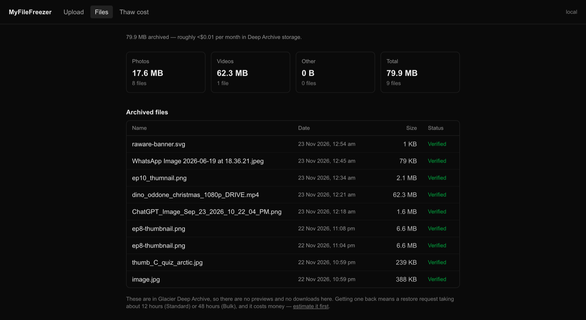
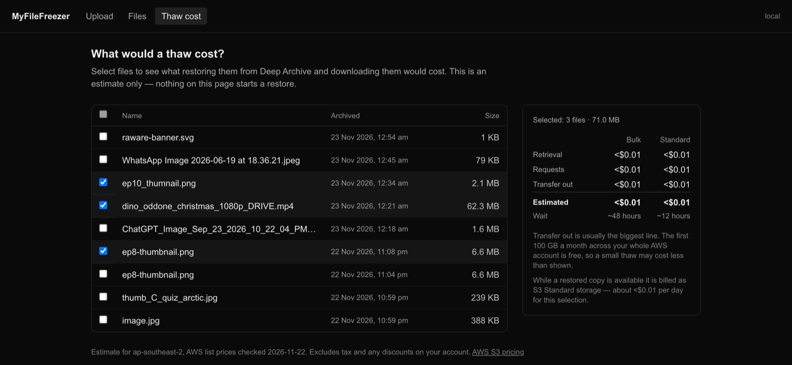
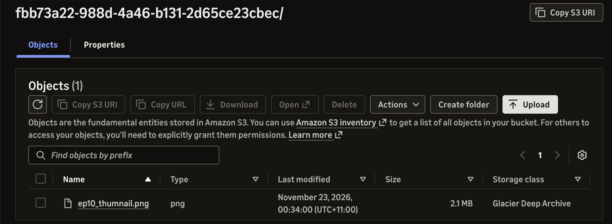
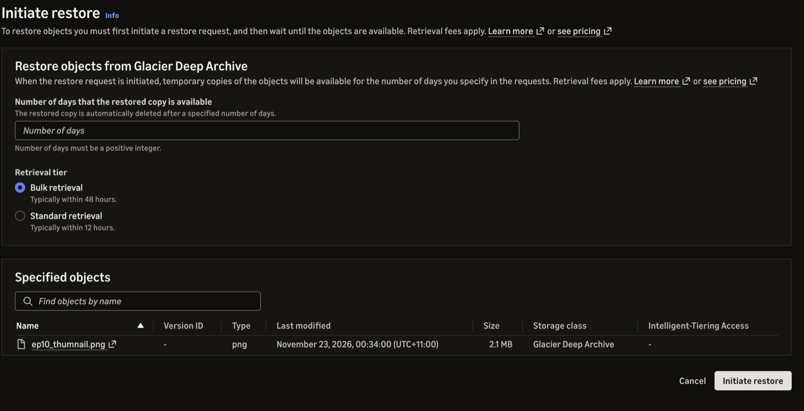

# MyFileFreezer

**Your data, your bucket.** A small app you run on your own machine that uploads photos and
videos straight into *your* AWS account's S3 Glacier Deep Archive — the cheapest storage
Amazon sells — and keeps a ledger of what is in there. You pay Amazon directly. Nobody else
holds your files or your metadata.

**What it is not:** a backup you browse. Deep Archive is a freezer. Getting a file back
means asking AWS to thaw it, waiting 12–48 hours, and paying for the retrieval. It is for
the second copy of things you cannot replace and hope never to need — the family photos
already on your phone, the wedding video, the old hard drive — not for files you open.

MIT licensed. Fork it, change it, run it.





---

## Quick start

> **Experimental, not yet tested against a real AWS account. Review before running.** The
> manual [Setup](#setup) section below is the tested path.

**For a personal laptop only** — one person, one computer. It skips Google sign-in; the app
only accepts connections from this computer, but anyone using it can reach the app. Sign-in
is optional and covered in [Setup](#2-google-sign-in).

You need an AWS account, Node.js 22.18+, and the
[AWS CLI](https://docs.aws.amazon.com/cli/latest/userguide/getting-started-install.html)
signed in with an admin identity (`aws login` in a recent CLI, or `aws configure`). With
the CLI already set up this takes about 10 minutes; installing it adds 10–20 more the first
time.

```bash
npm install
npm run setup-aws                          # bucket, IAM user, $5 budget alert, .env.local
echo 'DISABLE_AUTH=true' >> .env.local     # skip Google sign-in
npm run dev                                # open http://localhost:3000
```

`setup-aws` shows which AWS account it will use and asks before changing anything. It
creates the bucket (public access blocked, SSE-S3 encryption, CORS, the abort-incomplete-
uploads rule), an IAM user that can upload but cannot delete or restore, and a $5/month
budget that emails you. It writes the keys into `.env.local` without printing the secret.
Running it again skips whatever already exists.

---

## Why

Deep Archive costs about **$1 per TB per month** (us-east-1). Consumer cloud storage costs
about ten times that.

| Storing ~1 TB | Per month | Notes |
|---|---|---|
| **S3 Glacier Deep Archive**, us-east-1 | **$1.01** | You pay for exactly what you store |
| S3 Glacier Deep Archive, Sydney | $2.05 | Rates vary by region — see below |
| iCloud+ 2 TB | $9.99 | No 1 TB tier; 2 TB is the next step up |
| Google One 2 TB | $9.99 | |
| Dropbox Plus 2 TB | $11.99 | $9.99/mo billed annually |

<sub>US list prices, checked November 2026. Consumer plans change often; check before deciding.</sub>

**The catch, stated plainly:**

- **Getting files back costs money and takes time.** 12 hours (Standard) or 48 hours (Bulk),
  plus a retrieval fee, plus — usually the biggest part — data transfer out to download it.
  The app's **Thaw cost** page tells you the full figure before you commit to anything.
- **180-day minimum.** Every object is billed for at least 180 days, even if deleted sooner.
- **Those services sync, preview and share.** This does none of that. It is a vault.

---

## The real cost

What it costs to put photos in, keep them, and get **all** of them back, from the prices in
[`src/lib/pricing.ts`](src/lib/pricing.ts).

- **Save** — one-time request fees for uploading. Sending data in is free; Deep Archive
  charges per file.
- **Hold** — storage, including the ~40 KB AWS adds per file.
- **Thaw** — retrieval + restore requests + download to the internet, for everything.

<!-- cost-tables:start — regenerate with `npm run cost-tables` -->
#### US East (N. Virginia) — `us-east-1`

| Stored | Files | Save (once) | Hold / month | Hold / year | Thaw Bulk (~48 h) | Thaw Standard (~12 h) |
|---|--:|--:|--:|--:|--:|--:|
| 1 GB | 205 | $0.01 | <$0.01 | $0.01 | $0.10 | $0.13 |
| 10 GB | 2,048 | $0.12 | $0.01 | $0.12 | $0.98 | $1.30 |
| 100 GB | 20,480 | $1.23 | $0.10 | $1.24 | $9.76 | $13.05 |
| 1 TB | 209,715 | $12.58 | $1.06 | $12.68 | $99.96 | $133.61 |

<details><summary>Show in INR, AUD, GBP</summary>

**INR**

| Stored | Files | Save (once) | Hold / month | Hold / year | Thaw Bulk (~48 h) | Thaw Standard (~12 h) |
|---|--:|--:|--:|--:|--:|--:|
| 1 GB | 205 | ₹1.14 | ₹0.10 | ₹1.15 | ₹9.05 | ₹12.09 |
| 10 GB | 2,048 | ₹11.39 | ₹0.96 | ₹11.48 | ₹90.47 | ₹120.93 |
| 100 GB | 20,480 | ₹113.89 | ₹9.57 | ₹114.79 | ₹904.74 | ₹1,209.29 |
| 1 TB | 209,715 | ₹1,166.18 | ₹97.95 | ₹1,175.44 | ₹9,264.56 | ₹12,383.11 |

**AUD**

| Stored | Files | Save (once) | Hold / month | Hold / year | Thaw Bulk (~48 h) | Thaw Standard (~12 h) |
|---|--:|--:|--:|--:|--:|--:|
| 1 GB | 205 | A$0.02 | <A$0.01 | A$0.02 | A$0.15 | A$0.20 |
| 10 GB | 2,048 | A$0.18 | A$0.02 | A$0.19 | A$1.46 | A$1.96 |
| 100 GB | 20,480 | A$1.84 | A$0.15 | A$1.86 | A$14.64 | A$19.57 |
| 1 TB | 209,715 | A$18.88 | A$1.59 | A$19.03 | A$149.96 | A$200.44 |

**GBP**

| Stored | Files | Save (once) | Hold / month | Hold / year | Thaw Bulk (~48 h) | Thaw Standard (~12 h) |
|---|--:|--:|--:|--:|--:|--:|
| 1 GB | 205 | <£0.01 | <£0.01 | <£0.01 | £0.07 | £0.10 |
| 10 GB | 2,048 | £0.09 | <£0.01 | £0.09 | £0.74 | £0.99 |
| 100 GB | 20,480 | £0.94 | £0.08 | £0.94 | £7.44 | £9.94 |
| 1 TB | 209,715 | £9.59 | £0.81 | £9.66 | £76.16 | £101.80 |

</details>

#### Asia Pacific (Mumbai) — `ap-south-1`

| Stored | Files | Save (once) | Hold / month | Hold / year | Thaw Bulk (~48 h) | Thaw Standard (~12 h) |
|---|--:|--:|--:|--:|--:|--:|
| 1 GB | 205 | $0.02 | <$0.01 | $0.02 | $0.12 | $0.16 |
| 10 GB | 2,048 | $0.16 | $0.02 | $0.25 | $1.20 | $1.58 |
| 100 GB | 20,480 | $1.64 | $0.21 | $2.46 | $12.04 | $15.79 |
| 1 TB | 209,715 | $16.78 | $2.10 | $25.21 | $123.33 | $161.67 |

<details><summary>Show in INR, AUD, GBP</summary>

**INR**

| Stored | Files | Save (once) | Hold / month | Hold / year | Thaw Bulk (~48 h) | Thaw Standard (~12 h) |
|---|--:|--:|--:|--:|--:|--:|
| 1 GB | 205 | ₹1.52 | ₹0.19 | ₹2.28 | ₹11.16 | ₹14.63 |
| 10 GB | 2,048 | ₹15.18 | ₹1.90 | ₹22.82 | ₹111.63 | ₹146.32 |
| 100 GB | 20,480 | ₹151.85 | ₹19.01 | ₹228.17 | ₹1,116.27 | ₹1,463.19 |
| 1 TB | 209,715 | ₹1,554.91 | ₹194.70 | ₹2,336.43 | ₹11,430.66 | ₹14,983.11 |

**AUD**

| Stored | Files | Save (once) | Hold / month | Hold / year | Thaw Bulk (~48 h) | Thaw Standard (~12 h) |
|---|--:|--:|--:|--:|--:|--:|
| 1 GB | 205 | A$0.02 | <A$0.01 | A$0.04 | A$0.18 | A$0.24 |
| 10 GB | 2,048 | A$0.25 | A$0.03 | A$0.37 | A$1.81 | A$2.37 |
| 100 GB | 20,480 | A$2.46 | A$0.31 | A$3.69 | A$18.07 | A$23.68 |
| 1 TB | 209,715 | A$25.17 | A$3.15 | A$37.82 | A$185.03 | A$242.53 |

**GBP**

| Stored | Files | Save (once) | Hold / month | Hold / year | Thaw Bulk (~48 h) | Thaw Standard (~12 h) |
|---|--:|--:|--:|--:|--:|--:|
| 1 GB | 205 | £0.01 | <£0.01 | £0.02 | £0.09 | £0.12 |
| 10 GB | 2,048 | £0.12 | £0.02 | £0.19 | £0.92 | £1.20 |
| 100 GB | 20,480 | £1.25 | £0.16 | £1.88 | £9.18 | £12.03 |
| 1 TB | 209,715 | £12.78 | £1.60 | £19.21 | £93.97 | £123.18 |

</details>

<sub>Exchange rates: 1 USD = 92.68 INR, 1.5002 AUD, 0.76192 GBP (European Central Bank reference rates, 2026-11-20). Approximate; your card or bank will use its own rate.</sub>
<!-- cost-tables:end -->

Assumptions:

- **Average file 5 MB** (phone photos), so 1 TB is about 210,000 files. Per-file fees
  (Save, and the request part of Thaw) scale with the number of files, not their size —
  video is cheaper per GB.
- **Thaw is the worst case.** It ignores the 100 GB of free internet download AWS gives each
  account per month, so a small thaw can cost less than shown.
- **180-day minimum.** Every file is billed for at least 6 months of Hold, even if you
  delete it sooner.
- Tax not included.

**Storing is cheap. Getting everything back is not. Thaw only what you need.**

The app's **Thaw cost** page prices exactly the files you tick. Today you choose them by
name; [thumbnail previews](https://github.com/alwaysarafath/myfilefreezer/issues/2) would
make that easier and are open for anyone to build.

---

## Costs in detail

Figures are us-east-1 / Sydney (`ap-southeast-2`). The app carries a table for ten regions
in [`src/lib/pricing.ts`](src/lib/pricing.ts), taken from AWS's published price list.

| | us-east-1 | Sydney |
|---|---|---|
| Storage, per GB-month | $0.00099 | $0.002 |
| Upload (data in) | free | free |
| Upload requests, per 1,000 files | $0.06 | $0.071 |
| Retrieval — **Bulk** (~48 h), per GB | $0.0025 | $0.005 |
| Retrieval — **Standard** (~12 h), per GB | $0.02 | $0.024 |
| Restore requests, per 1,000 files | $0.025 Bulk / $0.10 Standard | $0.03 / $0.12 |
| Data transfer out to the internet, per GB | $0.09 | $0.114 |

- **Egress dominates.** Thawing 100 GB in Bulk from us-east-1 costs $0.25 in retrieval
  fees and about $9 to download. The first 100 GB a month across your AWS account is free.
- **180-day minimum storage charge** per object.
- **~40 KB overhead per object** — 32 KB billed at Deep Archive rates and 8 KB at S3
  Standard rates, for the index AWS keeps. About 1% on a 5 MB photo; irrelevant on video.
- **Restored copies** are billed as S3 Standard storage for the number of days you ask to
  keep them available.

Region choice matters mostly for egress. If you have no reason to pick otherwise, a US
region is cheapest.

---

## Setup

Two accounts: AWS (for storage) and Google Cloud (for sign-in, free). Allow about 30 minutes
the first time.

### 1. AWS

#### Bucket

S3 console → **Create bucket**. Pick a region (see above) and a globally unique name.
**Block all public access: on** — all four checkboxes.

#### Default encryption

Bucket → Properties → Default encryption → **SSE-S3**.

Not SSE-KMS: KMS bills per request, and a multipart upload makes one request per chunk, so
a large video would quietly rack up thousands of KMS charges.

#### CORS

Bucket → Permissions → Cross-origin resource sharing:

```json
[
  {
    "AllowedOrigins": ["http://localhost:3000", "http://127.0.0.1:3000"],
    "AllowedMethods": ["PUT", "POST", "GET", "HEAD"],
    "AllowedHeaders": ["*"],
    "ExposeHeaders": ["ETag", "x-amz-checksum-sha256"]
  }
]
```

> **`ExposeHeaders` is the one people get wrong.** Without `ETag` the browser cannot read
> each part's identifier, which the final step needs — so uploads appear to work and then
> fail right at the end.

#### Lifecycle rule

Bucket → Management → **Create lifecycle rule**:

- Name: `abort-incomplete-multipart`, scope: whole bucket
- Action: **Delete expired object delete markers or incomplete multipart uploads** →
  **Delete incomplete multipart uploads** after **7 days**

Parts from abandoned uploads don't show in the object list but are still billed. This rule
stops that slow, invisible leak.

#### IAM user and access keys

IAM → Users → **Create user** (no console access). Attach this inline policy, replacing
`YOUR-BUCKET` in both places:

```json
{
  "Version": "2012-10-17",
  "Statement": [
    {
      "Sid": "Objects",
      "Effect": "Allow",
      "Action": [
        "s3:PutObject",
        "s3:AbortMultipartUpload",
        "s3:ListMultipartUploadParts",
        "s3:GetObject"
      ],
      "Resource": "arn:aws:s3:::YOUR-BUCKET/*"
    },
    {
      "Sid": "ReindexListing",
      "Effect": "Allow",
      "Action": "s3:ListBucket",
      "Resource": "arn:aws:s3:::YOUR-BUCKET"
    }
  ]
}
```

Note the second statement targets the bucket itself (no `/*`) — `ListBucket` is a bucket
permission, and it is what lets `npm run reindex` rebuild the ledger.

Deliberately absent: `s3:DeleteObject` and `s3:RestoreObject`. The app does neither, so its
keys cannot either. `s3:GetObject` is there for the post-upload `HeadObject` check; while
objects are in Deep Archive it can only read metadata.

Then user → Security credentials → **Create access key** → "Application running outside
AWS". Keep the key ID and secret for step 3.

#### Billing alarm — do not skip this

The app enforces no storage limit: it is your account and your bill. The right spending
guard is one that sees your *whole* AWS bill, not just this app.

Billing → **Budgets** → Create budget → **Monthly cost budget** template. Set an amount
you'd be surprised to exceed (say $5) and your email. AWS will email you at 85% and 100%,
and if forecast spend is heading over.

### 2. Google sign-in

Sign-in stops anyone else on your network from reaching an app that can spend your money.

1. [Google Cloud Console](https://console.cloud.google.com/) → create a project.
2. APIs & Services → **OAuth consent screen** → External. Add your own Google address as a
   test user. (Leaving it in "Testing" is fine — you are the only user.)
3. Credentials → **Create credentials → OAuth client ID** → Web application.
4. Authorized redirect URI:

   ```
   http://localhost:3000/api/auth/callback/google
   ```

5. Copy the client ID and secret.

**Skipping it:** the app only listens on `127.0.0.1`, so other devices on your network
cannot reach it whether or not sign-in is on. If you are the only person using this
computer, you can set `DISABLE_AUTH=true` and skip this section entirely. Keep sign-in if
the computer is shared.

### 3. Run it

Requires **Node.js 22.18 or newer** (for the built-in `node:sqlite`). Check with `node -v`.

```bash
git clone <your fork> myfilefreezer && cd myfilefreezer
npm install
cp .env.local.example .env.local   # then fill it in
npm run dev
```

`.env.local`:

| Variable | |
|---|---|
| `ALLOWED_EMAIL` | The one Google address allowed in. Anyone else is refused. |
| `AUTH_SECRET` | `openssl rand -base64 32` |
| `AUTH_GOOGLE_ID`, `AUTH_GOOGLE_SECRET` | From step 2 |
| `AWS_REGION` | Your bucket's region, e.g. `us-east-1`. Also selects the pricing table. |
| `AWS_S3_BUCKET` | Bucket name |
| `AWS_ACCESS_KEY_ID`, `AWS_SECRET_ACCESS_KEY` | From the IAM user |
| `DB_PATH` | Optional. Defaults to `./data/myfilefreezer.db` |

Open http://localhost:3000. The app listens on `127.0.0.1` only — reachable from this
computer, not from anything else on your network.

**Check your first upload in the S3 console** (object → Properties): storage class
`Glacier Deep Archive`, encryption `SSE-S3`, a SHA-256 checksum present. The app checks the
same things itself before calling a file *verified*, but it is worth seeing once with your
own eyes.



---

## How it works

```
Browser
  │  1. POST /api/uploads/create     record in SQLite, S3 CreateMultipartUpload (DEEP_ARCHIVE, SSE-S3)
  │  2. hash each chunk              SHA-256 via WebCrypto
  │  3. POST /api/uploads/sign-part  presigned PUT, checksum bound into the signature
  │  4. PUT to S3 directly           bytes never pass through the Next.js server
  │  5. POST /api/uploads/complete   CompleteMultipartUpload → HeadObject → verified
  ▼
data/myfilefreezer.db  (SQLite: the ledger)
```

- **S3 verifies every chunk.** Each part carries its SHA-256; S3 rejects a part whose bytes
  don't match, and the signature stops the browser swapping in a different hash.
- **"Safe to delete" is earned, not assumed.** A file is marked verified only after it has
  been read back from S3 with the right size and the `DEEP_ARCHIVE` storage class. That
  flag is what tells you it's fine to clear the copy off your phone.
- **Uploads resume.** Chunks retry individually, so a dropped connection costs one chunk,
  not the whole file.
- **Previews exist only during upload**, from the file in your browser. Deep Archive cannot
  serve a thumbnail, and keeping a warm copy somewhere would defeat the point.
- **The thaw page only estimates.** Nothing in the app calls `RestoreObject`.

---

## Getting files back

Files in Deep Archive cannot be downloaded directly. You ask AWS to **restore** a temporary
copy, wait for it, then download that. The original stays in Deep Archive the whole time;
the temporary copy expires by itself after the number of days you choose.

The app does not do this for you, and its access key deliberately cannot. Use your own AWS
login instead — the simplest is **AWS CloudShell** (the `>_` icon in the AWS console), which
already has the AWS CLI and your permissions.

**Check the cost first** on the app's **Thaw cost** page.

### A few files: the S3 console

1. Find the file's path. Each file sits in its own `archive/<id>/` folder and the console
   search only matches the start of a path, so it is quickest to ask CloudShell:
   `aws s3 ls s3://your-bucket-name/ --recursive | grep -i beach`. Then open that path
   in S3 → your bucket.
2. **Actions → Initiate restore**. Choose how many days to keep the copy, and **Bulk**
   (~48 hours, cheapest) or **Standard** (~12 hours).
3. Come back later. When the object's **Restoration status** says completed, use
   **Download**.



### Many files: the AWS CLI

```bash
BUCKET=your-bucket-name

# 1. Find keys (photos are stored as archive/<id>/<name>)
aws s3 ls "s3://$BUCKET/" --recursive | grep -i beach

# 2. Request a restore. Days = how long the temporary copy is kept.
aws s3api restore-object --bucket "$BUCKET" --key "archive/…/Beach_day.jpg" \
  --restore-request '{"Days":7,"GlacierJobParameters":{"Tier":"Bulk"}}'

# 3. Check progress: ongoing-request="true" while waiting, "false" plus an expiry when ready
aws s3api head-object --bucket "$BUCKET" --key "archive/…/Beach_day.jpg" --query Restore

# 4. Download — or make a link to open on any device (valid for an hour):
aws s3 cp "s3://$BUCKET/archive/…/Beach_day.jpg" .
aws s3 presign "s3://$BUCKET/archive/…/Beach_day.jpg" --expires-in 3600
```

To restore everything, loop over the keys:

```bash
aws s3 ls "s3://$BUCKET/" --recursive | awk '{print $4}' | while read -r key; do
  aws s3api restore-object --bucket "$BUCKET" --key "$key" \
    --restore-request '{"Days":7,"GlacierJobParameters":{"Tier":"Bulk"}}'
done
```

For tens of thousands of files, AWS's S3 Batch Operations is the better tool. Full details:
[Restoring an archived object](https://docs.aws.amazon.com/AmazonS3/latest/userguide/restoring-objects.html).

---

## From your phone

The app runs on your computer, so photos go phone → computer → app:

- **iPhone to Mac:** AirDrop, or import into Photos and use **File → Export → Export
  Unmodified Original** — that keeps the full-quality HEIC or video rather than a
  compressed copy.
- **Android or Windows:** USB cable, or download originals from your photo backup service.

Then drag them onto the **Upload** page. Once a file shows *safe to delete*, it is safely
in your bucket and verified, and you can remove it from the phone.

Uploading straight from a phone's browser is not supported yet: browsers only allow the
per-chunk checksums over HTTPS or on the computer itself, and the app does not serve HTTPS.

---

## Recovery

**Losing `data/myfilefreezer.db` does not lose your files.** The database is an index over
the bucket, not the source of truth. To rebuild it, **stop the app first**, then:

```bash
rm -f data/myfilefreezer.db*     # the * matters: also removes the -wal and -shm files
npm run reindex
npm run dev
```

Deleting the database while the app is running can lose the rebuilt rows: the running
server keeps the old file open, and both end up writing to the same `-wal` file.

It lists your bucket and re-creates a row for every object the app wrote. What it cannot
bring back is anything only the index knew: original filenames come back in their sanitised
S3-key form (`Beach day.jpg` → `Beach_day.jpg`), and content type is inferred from the
extension.

---

## Not included

Performing restores, downloads, deletion, multiple users, hosted deployment. The thaw page
deliberately stops at telling you what a thaw would cost.

## License

[MIT](LICENSE)
